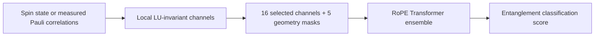

# EntNet: spin-chain entanglement from local correlations

EntNet diagnoses entanglement in finite-temperature spin chains from low-order
Pauli correlations. Local-unitary (LU) invariant contractions remove arbitrary
local basis choices; a frozen set of 16 physical channels, five geometry masks,
and a RoPE Transformer produce an **empirical classification score**. This
score is neither a rigorous entanglement witness nor a calibrated entanglement
probability. PPT/CCNR and constructive certificates define evaluation labels;
uncertified states are excluded from classification metrics.



The **baseline EntNet** is the frozen three-seed Dv1-only ensemble used for
the main XY, system-size, synthetic-state, and unseen-Hamiltonian benchmarks.
The **distance-two-augmented EntNet** is a separate three-seed Dv1+R2Support
ensemble used for the Fig. 3(c,d) thermal map and the distance-two intervention.
The frozen channel ranking was selected using Dv1 plus auxiliary selection
collections; the baseline classifier itself was retrained on Dv1-only rows.
The two ensembles must not be interchanged.

## Install

Python 3.10 or newer is required. From a fresh clone:

```bash
python -m venv .venv
source .venv/bin/activate                 # Linux/macOS
python -m pip install --upgrade pip
python -m pip install -e '.[test]'
python -m pytest -q tests
```

On Windows PowerShell, activate with `.venv\Scripts\Activate.ps1` instead.
Windows may reject an editable install from a deeply nested clone with
`WinError 206` (path too long). Clone to a short path such as `C:\entnet`.
If a short clone path is unavailable, the following dependency-only install
was also verified. Set the source path for scripts that import the package:

```powershell
python -m pip install torch numpy h5py PyYAML psutil scipy 'scikit-learn>=1.5,<2' pandas matplotlib pfapack pytest
$env:PYTHONPATH = (Resolve-Path 'src').Path
```

PyTorch may require a platform-specific CPU or CUDA wheel. TeNPy is optional
and needed only for some full thermal-data generation routes.

## Quick start: real physical inputs

```bash
python scripts/physical_example.py
```

This constructs a separable 16-spin product state and a Bell pair embedded in
a 16-spin chain. It calculates their canonical low-order Pauli correlations,
extracts all 122 local token channels, applies the frozen 16-channel selection
and each checkpoint's own normalization, and prints ensemble scores. The Bell
pair is independently certified by a two-site NPT test. No output score is
assigned by hand. For a short saved-input compatibility check, run
`python scripts/infer_example.py`.

## Benchmark data

The six final HDF5 benchmarks total 5,932 rows and about 116 MB uncompressed.
Their verified paths, per-file SHA-256 values, labels, schemas, and provenance
are in [`data/benchmark_manifest.json`](data/benchmark_manifest.json) and
[`DATA_ACCESS.md`](DATA_ACCESS.md). They are deliberately outside Git history.

The data package has been prepared and locally tested, but **its public release
asset is not yet published**. Until the manifest contains a live URL, the
default download command gives an explicit error. A holder of the verified
package can install it now:

```bash
python scripts/download_benchmarks.py --archive-file /path/to/entnet-benchmarks-v1.tar.gz
```

Once the public asset is released and the manifest updated, the command is:

```bash
python scripts/download_benchmarks.py
```

Both routes check archive and individual HDF5 SHA-256 hashes, skip verified
files, and put the data under `data/benchmarks/`. The archive SHA-256 is
`dc8bf42f7ac56b97f1f477a86e0300bd7f35ca14727522211cd4bad9a96027ca`.

## Reproduce the paper

### Recompute the six frozen-model benchmarks

After obtaining the HDF5 package:

```bash
python scripts/reproduce_benchmarks.py --data-root data/benchmarks --output outputs/benchmarks
```

This single command verifies all six file hashes, loads the three baseline
checkpoints, applies the correct schema adapter and saved per-seed normalizers,
recomputes per-row scores, and reports AUROC, E2/E3/E4 and higher-order recall,
true-negative rate (TNR), counts, and differences from manuscript reference
values. The threshold is fixed at `p=0.5`; unknown rows enter no labeled
metric. `N32-XY` and `N32-synthetic` are distinct datasets. Results go only to
`outputs/` by default. To evaluate a *different* HDF5 in canonical
`features/X` format, use `scripts/evaluate_final.py`; it does not accept the
six release-specific schemas.

### Redraw figures from compact numerical data

```bash
python paper_reproduction/figures/plot_fig2.py
python paper_reproduction/figures/plot_fig3.py
```

These commands redraw Fig. 2 and Fig. 3 from the committed compact source
tables and direct thermal prediction grids. They **do not** rerun model
inference. Their PDFs and previews are written to `outputs/figures/`.
Fig. 3(a,b) uses baseline trajectory scores and independent certificates;
Fig. 3(c,d) uses the distance-two-augmented ensemble. The 19-point activated
lower-boundary fit gives `C_* = 0.0020259765`,
`R²(log10 T_*) = 0.9994261`, and `RMSE(log10 T_*) = 0.0061410`.

To recompute Fig. 3(c,d) predictions from exact XY thermal correlations
instead of redrawing saved grids, run
`scripts/recompute_xy_thermal_r2support.py` and then
`scripts/recompute_xy_thermal_dense.py --workers 4`; this is substantially
more expensive. Reference files in `reports/phase3_thermal/` stay unchanged.
Fig. 1 is an author-supplied schematic and is outside this code package.

| Paper result | Entry point and input | Model |
| --- | --- | --- |
| Fig. 2: selected channels, K budget, LU controls | `paper_reproduction/figures/plot_fig2.py`; `paper_reproduction/data/` | Frozen selector results and Dv1-only controls |
| Fig. 2: unseen Hamiltonians, size and synthetic transfer | `scripts/reproduce_benchmarks.py`; six HDF5 files | Baseline EntNet |
| Fig. 3(a,b): XY temperature trajectories/certificates | `paper_reproduction/figures/plot_fig3.py`; compact trajectory table | Baseline EntNet and independent PPT/CCNR |
| Fig. 3(c,d): XX thermal map and fit | `plot_fig3.py` or the two recomputation scripts; final thermal grids | Distance-two-augmented EntNet |
| Appendix: r=4 pair ablation and intervention | `plot_fig2.py`; compact ablation/intervention tables | Dv1-only ablation and augmented intervention |

## Data generation and training

The core code is in `src/entanglement_data/`: MPS and thermal states,
Pauli-moment extraction, PPT/CCNR certificates, LU-invariant contractions,
channel selection, and the Transformer. The committed configs fix the paper's
generator and model settings. The full N=16 Dv1 generator begins with:

```bash
python scripts/generate_production.py --config configs/production_n16_v1.yaml --output outputs/training_source/data/n16_production_v1 --pilot-only
```

After inspecting its pilot gate, run the same command with `--skip-pilot` in
place of `--pilot-only`. Full generation is costly and is not part of the
quick start. Other generator entry points and required resources are listed
in [`DATA_ACCESS.md`](DATA_ACCESS.md). The final baseline training route needs
the complete Dv1 HDF5 at `outputs/training_source/data/n16_production_v1/dataset.h5`, a 122-channel
cache, and the frozen `configs/joint_K16.json`. Build the cache and train one
seed with:

```bash
python scripts/prepare_final_training_cache.py --dataset outputs/training_source/data/n16_production_v1/dataset.h5 --cache-dir outputs/training_cache
python scripts/train_final_joint_k16.py --seed 20260829 --source-root outputs/training_source --cache-dir outputs/training_cache --models-dir outputs/models --analysis-dir outputs/training_audit --device cuda --train-only
```

Repeat for seeds `20260830` and `20260831`. Training uses the recorded
35,000/7,500/7,500 Dv1 split; complete three-seed training and all original
data generation have not been rerun for this release. A fast, independent
integration check uses genuine physical XY rows and the **same final training
entry point** for one CPU epoch:

```bash
python scripts/smoke_train_dv1.py
```

It creates a smoke-only checkpoint under ignored `outputs/`, never replaces
released weights, and is not a scientific performance result.

## Repository guide and reproducibility boundaries

`src/` implements physics and ML; `scripts/` contains generation, training,
evaluation and download entry points; `configs/` fixes model and generator
inputs; `checkpoints/` holds six final seed checkpoints; `data/` contains the
benchmark manifest; `paper_reproduction/` has compact figure sources and plot
code; `reports/` holds frozen reference results; `tests/` has physics,
certificate, feature, and model checks; `outputs/` is ignored user output.

The public CI checks frozen-model inference and a small end-to-end training
route. Local verification also reran all six HDF5 benchmarks and both major
figures. Full regeneration needs more time and optional dependencies. The
training-time Git commit of the released weights is unknown; inference matches
saved references within documented floating-point tolerance. See
[`PROVENANCE.md`](PROVENANCE.md) and [`VALIDATION.md`](VALIDATION.md) for exact
hashes, test scope, and remaining limits.

## Citation and license

Please cite the associated manuscript when its public bibliographic record is
available. The repository title is currently the stable citation identifier;
author, journal, and DOI metadata will be added when confirmed. **No
open-source license has been granted.** Public availability does not imply
permission to redistribute or modify this code or the included weights;
contact the authors for permissions.
